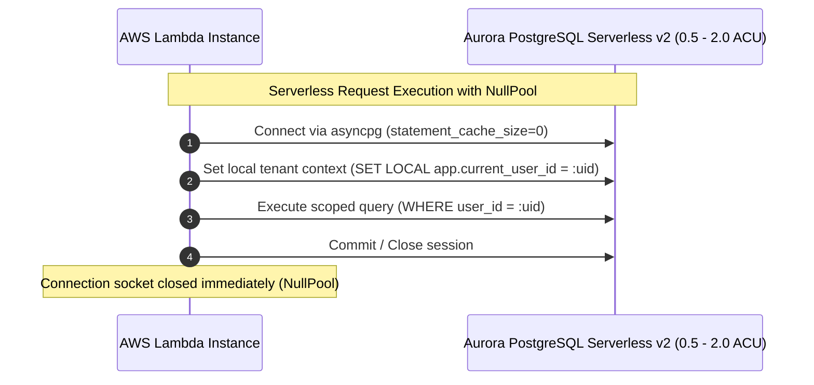
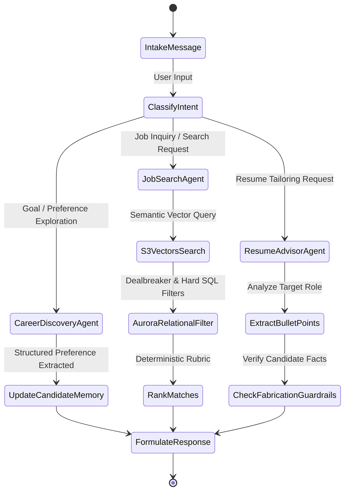

# Architecture Specification: AI Career Platform

> **Status**: Approved Foundation (AWS-Native Target Architecture)  
> **Audience**: Technical Lead, Software Engineers, AI Coding Agents  
> **Target Region**: AWS `ap-south-1` (Mumbai)  
> **Revision**: 2.0 (Phase 01 Architecture Migration)

---

## 1. Architectural Paradigm: Modular Monolith on AWS Serverless

The **AI Career Platform** is designed as a **Modular Monolith** running on an AWS-Native Serverless and Managed Cloud Infrastructure co-located in AWS `ap-south-1` (Mumbai).

### Rationale
- Distributed microservices introduce operational friction, network latency, distributed transactions, and high idle infrastructure costs that are unjustified for this stage of the platform.
- A well-architected modular monolith enforces strict domain boundaries inside `apps/api/app/modules/` through well-defined internal interfaces, schemas, and dependency injection.
- Moving to an AWS-native foundation consolidates authentication, compute, relational storage, vector indexing, document storage, and asynchronous event processing within a single unified cloud boundary under AWS IAM, Terraform IaC, and GitHub Actions OIDC governance.

```mermaid
flowchart TD
    Client["Next.js 16 Web Client (Amplify / Vercel / CloudFront)"]
    Cognito["Amazon Cognito User Pools (ap-south-1)"]
    Gateway["AWS API Gateway HTTP API (JWT Authorizer)"]
    Lambda["FastAPI Backend (AWS Lambda + Mangum)"]
    Aurora[("Amazon Aurora PostgreSQL Serverless v2")]
    S3Vectors[("Amazon S3 Vectors (Candidate & Job Indexes)")]
    S3Docs[("Private Amazon S3 (Resumes & Documents)")]
    SQS["Amazon SQS (Task Queue + DLQ)"]
    WorkerLambda["Worker Lambda (Async Processing)"]
    EventBridge["Amazon EventBridge Scheduler (Asia/Kolkata)"]
    Bedrock["Amazon Bedrock (Titan Models / Pending Access)"]
    BYOKProviders["Candidate BYOK LLMs (NIM, CF AI, OpenRouter, Gemini)"]

    Client -->|1. Authenticate / Refresh| Cognito
    Client -->|2. HTTPS Request + Cognito JWT| Gateway
    Gateway -->|3. Perimeter JWT Validation| Gateway
    Gateway -->|4. Proxy Event| Lambda
    Lambda -->|5. SQL Relational Queries| Aurora
    Lambda -->|6. Vector Similarity Query| S3Vectors
    Lambda -->|7. Pre-signed URLs| S3Docs
    Lambda -->|8. Enqueue Async Workload| SQS
    Lambda -->|9. AI Inference (Platform)| Bedrock
    Lambda -->|10. AI Inference (BYOK)| BYOKProviders
    EventBridge -->|Daily 06:00 IST Trigger| SQS
    SQS -->|Batch Events| WorkerLambda
    WorkerLambda -->|Embed & Index| S3Vectors
    WorkerLambda -->|Update Status| Aurora
```

---

## 2. Component Boundaries & Responsibilities

### 2.1. Frontend (`apps/web`)
- **Technology**: Next.js 16 (App Router), TypeScript, Tailwind CSS.
- **Role**: Candidate-facing UI, authentication session handling (Amazon Cognito client), resume upload workflow, conversational career assistant chat interface, job comparison view, and preference settings.
- **Boundary**: Never interacts directly with database credentials, private S3 buckets, or internal background workers. Interacts exclusively with the FastAPI backend via REST endpoints carrying Amazon Cognito JWT access tokens.

### 2.2. Backend (`apps/api`)
- **Technology**: Python 3.12, FastAPI, Pydantic v2, SQLAlchemy 2.0 (Async), LangGraph, Mangum.
- **Role**: REST API routing, JWT token verification, domain business logic, prompt assembly, deterministic scoring engine, vector similarity retrieval coordination, and async job dispatch.
- **Module Structure**:
  ```text
  apps/api/app/
  ├── api/v1/         # Versioned HTTP routing controllers
  ├── core/           # Settings, logging, security, encryption, telemetry
  ├── db/             # SQLAlchemy engine, session generator, base models
  ├── modules/
  │   ├── auth/       # Cognito identity verification, CurrentUser, tenant isolation
  │   ├── candidate/  # Profile, resume parsing, candidate memory, S3 presigned URLs
  │   ├── jobs/       # Ingestion, normalization, search, S3 Vectors integration
  │   ├── matching/   # Compatibility scoring and comparison engine
  │   ├── agent/      # LangGraph workflows, Bedrock integration, BYOK routing
  │   └── digest/     # Daily email digest formulation and SQS dispatch
  ├── schemas/        # Cross-module Pydantic schemas
  └── main.py         # Application instantiation and ASGI lifespan
  ```

---

## 3. Authentication & Tenant Authorization Architecture

Authentication is managed via **Amazon Cognito User Pools** ([ADR-013](./adr/ADR-013-cognito-authentication.md)), replacing the previous Supabase Auth integration.

### 3.1. Perimeter vs. Application Verification
1. **Perimeter Defense (API Gateway HTTP API JWT Authorizer)**:
   - Configured with the Cognito User Pool issuer URL:
     `https://cognito-idp.ap-south-1.amazonaws.com/{userPoolId}`
   - Validates incoming Bearer tokens at the edge, rejecting expired, unsigned, or non-allowlisted tokens before invoking the backend Lambda.
   - Prevents unauthenticated requests from consuming Lambda execution time.
2. **Application Defense in Depth (FastAPI Middleware)**:
   - The backend validates the token against Cognito's public JWKS:
     `https://cognito-idp.ap-south-1.amazonaws.com/{userPoolId}/.well-known/jwks.json`
   - Enforces asymmetric `RS256` signature verification, issuer match, client ID match (`client_id` on access tokens or `aud` on ID tokens), and unexpired lifespan.
   - Extracts the authenticated `sub` (UUID) and injects an authenticated `CurrentUser` dependency into request handlers.

### 3.2. Authentication != Authorization
- Authentication verifies *identity*; application domain logic enforces *authorization*.
- Every database query for candidate-specific data must explicitly filter by the authenticated candidate ID:
  ```sql
  WHERE user_id = :current_user_id
  ```
- No user-supplied parameters in request bodies, path parameters, or query strings can override `current_user.id`.

---

## 4. Relational Database Architecture: Aurora PostgreSQL Serverless v2

The primary relational data store is **Amazon Aurora PostgreSQL Serverless v2** (PostgreSQL 16 compatible) in `ap-south-1` ([ADR-014](./adr/ADR-014-aurora-postgresql-serverless-v2.md)).



### 4.1. Evaluation of Lambda Connectivity Options
As documented in [ADR-014](./adr/ADR-014-aurora-postgresql-serverless-v2.md), three connectivity models were evaluated:
1. **RDS Data API over HTTPS**:
   - Executes SQL via stateless HTTPS calls. Eliminates Lambda VPC and NAT Gateway requirements.
   - **Limitation**: Not a drop-in replacement for `asyncpg`. Requires non-standard dialects (`sqlalchemy-aurora-data-api`), lacks async streaming cursors, and introduces dialect maintenance friction. Alembic DDL migrations require non-standard adapters.
2. **Conventional PostgreSQL TCP via `asyncpg`**:
   - Direct connection using standard SQLAlchemy 2.0 async engine (`postgresql+asyncpg://`).
   - Requires Lambda to reside within VPC private subnets. Lambda in VPC requires careful egress architecture to avoid the ~\$32/month NAT Gateway cost (e.g. VPC Endpoints for S3, SQS, Bedrock, Cognito).
   - Uses `poolclass=NullPool` to prevent connection leaks across ephemeral Lambda containers.
3. **RDS Proxy + VPC**:
   - Managed connection pooler.
   - **Rejected for Initial Phase**: Incurs fixed monthly charges (~**\$15–\$25/month**) and keeps warm connections open, preventing Aurora Serverless v2 from scaling to 0 ACUs when idle. Violates our \$200 budget constraint.

### 4.2. Recommended Connectivity Strategy
- **Local Development**: Uses local containerized PostgreSQL (`pgvector/pgvector:pg16`) via Docker Compose with standard `asyncpg`. Developers do not need Aurora cloud access.
- **Production Runtime**: Uses standard `asyncpg` with `NullPool` and strict Lambda concurrency caps (maximum 20 API instances, 5 SQS workers) to protect database connection pools.
- **Migration Execution**: Alembic runs strictly outside Lambda cold starts (during CI/CD deployment or migration runners) connecting directly to port 5432 with administrative credentials.

---

## 5. Vector Storage & Semantic Search: Amazon S3 Vectors

Vector similarity search is handled by **Amazon S3 Vectors** ([ADR-015](./adr/ADR-015-s3-vectors-for-vector-storage.md)), moving vector indexing out of the relational database memory space.

### 5.1. Separation of Responsibilities
- **Embedding Generation**: Handled by **Amazon Titan Text Embeddings V2** (`amazon.titan-embed-text-v2:0`) via Amazon Bedrock (or alternative providers).
- **Vector Storage & Indexing**: Handled by **Amazon S3 Vectors**. S3 Vectors indexes dense vector embeddings and executes approximate nearest neighbor (ANN) cosine similarity search.
- **Explicit Invariant**: S3 Vectors is **not** an embedding generation model; it stores and indexes vectors produced by embedding providers.

### 5.2. Two-Stage Hybrid Retrieval Pipeline

```mermaid
flowchart LR
    Query["Candidate Profile Embedding"] --> Stage1["Stage 1: Amazon S3 Vectors (ANN Cosine Search)"]
    Stage1 -->|Top-K Matching Job IDs (e.g. K=100)| Stage2["Stage 2: Aurora PostgreSQL (Relational Filtering)"]
    Stage2 -->|Filter Hard Dealbreakers & Constraints| Scorer["Deterministic Match Scoring Rubric"]
    Scorer --> Results["Ranked, Transparent Recommendations"]
```

1. **Stage 1 (Semantic Retrieval)**:
   - The candidate profile embedding is queried against `job-vectors-index` in S3 Vectors to retrieve the top-100 semantically relevant job IDs with similarity scores.
2. **Stage 2 (Relational Filtering & Deterministic Rubric)**:
   - The application queries Aurora PostgreSQL, filtering matching job IDs by hard relational constraints (locations, experience bands, salary floors, and candidate dealbreakers).
   - Qualified jobs are ranked via the deterministic compatibility scoring rubric (ADR-010).

### 5.3. Local Development & Testing Abstraction
- Vector operations are abstracted behind a `VectorStore` protocol.
- Local development and automated test suites use `FakeVectorStore` (in-memory cosine similarity calculation via Python/NumPy), requiring zero AWS credentials and zero network overhead.

---

## 6. Document Storage: Private Amazon S3

Candidate resumes and extracted documents are stored in **Private Amazon S3** ([ADR-012](./adr/ADR-012-resume-file-storage-and-secure-access.md)) in `ap-south-1`.

### 6.1. Security & Access Protocols
- **Block Public Access**: All 4 S3 Block Public Access settings enabled unconditionally.
- **Encryption at Rest**: SSE-KMS or SSE-S3 encryption enforced via bucket policy.
- **Candidate Partitioning**: `s3://career-platform-resumes-${env}/candidates/{user_id}/resumes/{resume_id}.pdf`.
- **Pre-Signed URLs**: Resumes are uploaded and downloaded strictly via time-limited (15-minute) pre-signed URLs generated after verifying `user_id == current_user.id`.
- **Validation**: Upload limits capped at 5 MB; MIME types restricted to PDF and DOCX; magic bytes verified before parsing.

---

## 7. AI & Agent Architecture: Bedrock and BYOK

Agentic workflows are orchestrated using **LangGraph** directed state graphs ([ADR-016](./adr/ADR-016-bedrock-foundation-model-integration.md)).



### 7.1. Amazon Bedrock Foundation Models
- **Target Family**: Amazon Titan foundation models (e.g. `amazon.titan-text-express-v1`, `amazon.titan-text-lite-v1`).
- **Anthropic Exclusion**: Anthropic models are **not** part of the planned production stack due to cost and licensing constraints.
- **Resilience & Feature Flagging**:
  - Bedrock access is currently subject to an account-level quota blocker with an open AWS Support case.
  - The application features an explicit toggle: `ENABLE_BEDROCK: bool = False`.
  - Bedrock availability is **not** a prerequisite for development or testing; the application falls back gracefully to `FakeLLMClient` or candidate BYOK providers.

### 7.2. Bring Your Own Key (BYOK) Integration
- Candidates can optionally connect personal API keys for NVIDIA NIM, Cloudflare Workers AI, OpenRouter, or Google Gemini.
- Keys are encrypted at rest using AES-256-GCM authenticated envelope encryption (ADR-009) and decrypted only in ephemeral execution memory.

### 7.3. Prompt Injection Defense
- Candidate resumes and job postings are treated as untrusted input.
- Structural delimiters provide context separation but are not security boundaries.
- **Non-Autonomous Authorization**: LLM outputs must never independently authorize database mutations or data exports. Tools adhere to strict Pydantic schemas validated out-of-band by application code.

---

## 8. Background Processing & Scheduling

Heavy, asynchronous, or recurring workloads run out-of-band via **Amazon SQS** and **Amazon EventBridge Scheduler** ([ADR-005](./adr/ADR-005-sqs-background-processing.md), [ADR-006](./adr/ADR-006-eventbridge-scheduler.md)).

```mermaid
flowchart LR
    Event["EventBridge Scheduler (Daily 06:00 IST)"] -->|Direct SQS Message| SQS["AWS SQS Queue"]
    HTTP["FastAPI Upload Endpoint"] -->|Enqueue Parse Task| SQS
    SQS -->|Batch Trigger (1-10 messages)| Worker["Worker Lambda"]
    Worker -->|Failed after 3 retries| DLQ["Dead-Letter Queue (DLQ)"]
    Worker -->|1. Generate Embeddings| Bedrock["Bedrock Titan V2"]
    Worker -->|2. Store Vectors| S3Vectors["Amazon S3 Vectors"]
    Worker -->|3. Persist State| Aurora[("Aurora PostgreSQL")]
```

1. **Amazon SQS & Visibility Timeout Best Practice**:
   - Manages asynchronous queues for resume parsing, embedding generation, and daily digest dispatch.
   - SQS visibility timeout is configured to **at least 6 times the Lambda timeout** (accounting for batching window and retry behavior) to prevent duplicate processing.
   - Poison messages are redirected to a Dead-Letter Queue (DLQ) after 3 failed receives (`maxReceiveCount = 3`).
2. **Amazon EventBridge Scheduler**:
   - Configured with explicit timezone **`Asia/Kolkata`** (`schedule_expression_timezone = "Asia/Kolkata"`).
   - Triggers the daily candidate digest formulation at **06:00 AM IST** (`cron(0 6 * * ? *)`) directly into SQS without intermediate compute.

---

## 9. Infrastructure as Code & Deployment

- **Primary Region**: AWS `ap-south-1` (Mumbai).
- **IaC**: 100% codified using **Terraform** (`infra/terraform/`) with S3 remote state and S3-native state locking (`use_lockfile = true`).
- **CI/CD**: GitHub Actions utilizing **AWS OIDC** (OpenID Connect) for secure, keyless cloud deployment roles.
