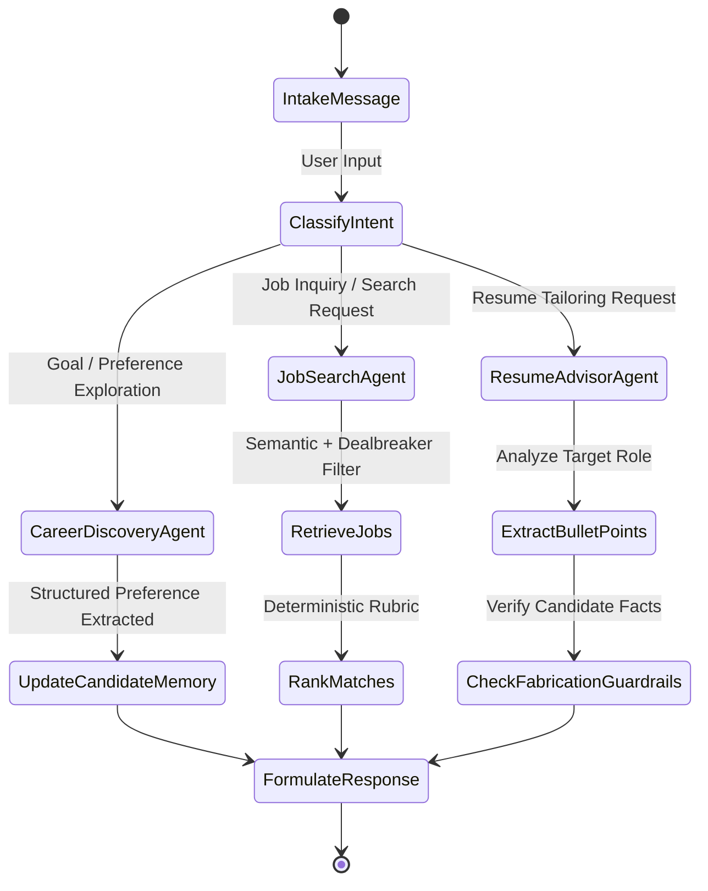

# Architecture Specification: AI Career Platform

> **Status**: Approved Foundation  
> **Audience**: Technical Lead, Software Engineers, AI Coding Agents  
> **Target Region**: AWS `ap-south-1` (Mumbai)  
> **Revision**: 1.0 (Phase 00)

---

## 1. Architectural Paradigm: Modular Monolith

The **AI Career Platform** is designed as a **Modular Monolith** running on a Serverless Cloud Infrastructure.

### Rationale
- Distributed microservices introduce operational friction, network latency, distributed transactions, and high idle infrastructure costs that are unjustified for this stage of the platform.
- A well-architected modular monolith enforces strict domain boundaries inside `apps/api/app/modules/` through well-defined internal interfaces and schemas.
- Monorepo structure allows frontend, backend, shared schemas, and infrastructure code to evolve in lockstep while remaining decoupled.

```mermaid
flowchart TD
    Client["Next.js Web Client (Vercel / CloudFront)"]
    Gateway["AWS API Gateway HTTP API (ap-south-1)"]
    Lambda["FastAPI Backend (AWS Lambda + Mangum)"]
    SQS["Amazon SQS (Task Queue + DLQ)"]
    WorkerLambda["Worker Lambda (Async Processing)"]
    EventBridge["Amazon EventBridge Scheduler"]
    SupabaseDB[("Supabase PostgreSQL + pgvector")]
    Storage[("Supabase / S3 Object Storage")]
    LLMProviders["BYOK LLM Providers (NIM, CF AI, OpenRouter, Gemini)"]

    Client -->|HTTPS / JWT| Gateway
    Gateway -->|ASGI Payload| Lambda
    Lambda -->|SQL / pgvector| SupabaseDB
    Lambda -->|Signed URLs| Storage
    Lambda -->|Dispatch Job| SQS
    Lambda -->|LLM Inference (BYOK)| LLMProviders
    EventBridge -->|Scheduled Cron Trigger| SQS
    SQS -->|Batch Events| WorkerLambda
    WorkerLambda -->|Update Status / Data| SupabaseDB
    WorkerLambda -->|Send Email| Client
```

---

## 2. Component Boundaries & Responsibilities

### 2.1. Frontend (`apps/web`)
- **Technology**: Next.js 16 (App Router), TypeScript, Tailwind CSS.
- **Role**: Candidate-facing UI, authentication session handling (Supabase Auth Client), resume upload workflow, conversational career assistant chat interface, job comparison view, and preference settings.
- **Boundary**: Never interacts directly with raw database credentials or internal background workers. Interacts exclusively with the FastAPI backend via REST endpoints carrying Supabase JWT access tokens.

### 2.2. Backend (`apps/api`)
- **Technology**: Python 3.12, FastAPI, Pydantic v2, SQLAlchemy 2.0 (Async), LangGraph, Mangum.
- **Role**: REST API routing, JWT token verification, domain business logic, prompt assembly, deterministic scoring engine, vector similarity retrieval, and async job dispatch.
- **Module Structure**:
  ```text
  apps/api/app/
  ├── api/v1/         # Versioned HTTP routing controllers
  ├── core/           # Settings, logging, security, encryption, telemetry
  ├── db/             # SQLAlchemy engine, session generator, base models
  ├── modules/
  │   ├── auth/       # User identity verification and tenant isolation
  │   ├── candidate/  # Profile, resume parsing, candidate memory
  │   ├── jobs/       # Ingestion, normalization, search, filtering
  │   ├── matching/   # Compatibility scoring and comparison engine
  │   ├── agent/      # LangGraph workflows and BYOK LLM integration
  │   └── digest/     # Daily email digest formulation and dispatch
  ├── schemas/        # Cross-module Pydantic schemas
  └── main.py         # Application instantiation and ASGI lifespan
  ```

---

## 3. Database Architecture & Connection Pooling

The primary data store is **Supabase PostgreSQL** augmented with the **`pgvector`** extension for vector similarity calculations.


### 3.1. Connection Management for Serverless AWS Lambda
Serverless execution models (AWS Lambda) spin up and tear down instances concurrently in response to incoming traffic. Standard persistent connection pools (`QueuePool`) will exhaust database connection limits.

To ensure stability and cost control:
1. **Supabase Transaction Pooler**: The application connects to Supabase via the shared PgBouncer / Supavisor pooler on **Port 6543** in **Transaction Pooling Mode**.
2. **SQLAlchemy Engine Configuration**:
   - `poolclass=NullPool`: The backend does not maintain an in-memory client connection pool across invocations. Connections are opened on demand and closed immediately after the request finishes.
   - `connect_args={"statement_cache_size": 0}`: In transaction pooling mode, prepared statements are not supported across varying physical backend sessions. Setting `statement_cache_size=0` on `asyncpg` prevents fatal "prepared statement does not exist" errors.
3. **Database Migration Isolation**:
   - Alembic runs **strictly outside** runtime Lambda execution (invoked via local CLI or CI/CD deployment jobs).
   - Alembic connects to **Port 5432 (Session Mode / Direct)** with dedicated administrative credentials because DDL operations and migrations require session-level locks and prepared statements.
4. **Tenant Isolation**:
   - All candidate-scoped queries enforce user isolation at the SQL layer: `WHERE candidate_profile.user_id = :authenticated_user_id`.

---

## 4. Agent Orchestration Architecture (LangGraph)

Agentic workflows (career intake, resume critique, search plan formulation) are implemented using **LangGraph** directed graphs.



### 4.1. Core Agent Nodes
1. **Intake & Intent Classifier**: Categorizes the candidate's conversational turn (updating goals, searching jobs, asking for advice).
2. **Career Discovery Agent**: Conducts structured dialog to uncover candidate aspirations, desired CTC, preferred work modes, and explicit dealbreakers. Updates candidate memory tables.
3. **Job Search & Retrieval Node**: Constructs vector queries for `pgvector` alongside SQL filters for hard dealbreakers.
4. **Recommendation & Match Scorer**: Runs a deterministic rubric to generate transparent match scores and explanations.
5. **Resume Tailoring Advisor**: Reviews existing candidate resume bullets against target job requirements, suggesting rephrasings while strictly verifying against candidate-confirmed experience.

### 4.2. BYOK (Bring Your Own Key) Provider Abstraction
To support user privacy and zero-marginal-cost operation:
- The system abstracts LLM inference behind a unified provider protocol (`LLMClient`).
- Supported providers: NVIDIA NIM, Cloudflare Workers AI, OpenRouter, Google Gemini.
- Candidate keys are encrypted at rest using AES-256-GCM envelope encryption and decrypted only in ephemeral execution memory.

---

## 5. Local Embeddings & Packaging Constraints

The target architecture prefers local/open-source Sentence Transformers embeddings (e.g., `all-MiniLM-L6-v2` or `bge-small-en-v1.5`).

### AWS Lambda ZIP Package Constraints
- AWS Lambda uncompressed ZIP deployment package size limit is **250 MB**.
- PyTorch and transformers runtimes frequently exceed 300–500 MB.
- **Architectural Investigation (ADR-011)**:
  - *Option A*: Package a lightweight ONNX Runtime with quantized model weights (< 120 MB) inside the ZIP deployment.
  - *Option B*: Offload embedding generation to a dedicated containerized worker or serverless inference endpoint (e.g., Cloudflare Workers AI / Fastembed).
  - *Resolution*: Investigated in ADR-011. The primary API Lambda must **not** be bloated with standard PyTorch wheels.

---

## 6. Background Task & Scheduled Workloads

Heavy or periodic tasks must never block synchronous user HTTP requests.

```mermaid
flowchart LR
    Event["EventBridge Cron (Daily 06:00 IST)"] -->|Send Batch Message| SQS["AWS SQS Queue"]
    HTTP["FastAPI Upload Endpoint"] -->|Enqueue Parse Task| SQS
    SQS -->|Trigger (Batch Size: 5)| Worker["Worker Lambda"]
    Worker -->|Failed 3x| DLQ["Dead-Letter Queue (DLQ)"]
    Worker -->|Success| DB[("Supabase PostgreSQL")]
```

1. **Amazon SQS**:
   - Manages asynchronous queues for: resume parsing, embedding generation, and daily digest dispatch.
   - Configured with a Dead-Letter Queue (DLQ) with `maxReceiveCount=3` for fault tolerance.
2. **Worker Lambda**:
   - Listens to SQS events, processes tasks idempotently, and records state back to PostgreSQL.
3. **EventBridge Scheduler**:
   - Triggers cron events (e.g., `cron(0 0 * * ? *)` - 05:30 AM IST) to formulate daily email digests.

---

## 7. AWS Serverless Deployment Architecture

- **AWS Region**: `ap-south-1` (Mumbai) to ensure low latency for Indian candidates.
- **API Gateway HTTP API**: Cost-effective managed gateway providing TLS termination, CORS configuration, and routing to Lambda.
- **Mangum Adapter**: Wraps the FastAPI ASGI application inside the standard AWS Lambda handler interface (`handler = Mangum(app)`).
- **Terraform**: Manages AWS API Gateway, Lambda functions, IAM roles, SQS queues, and EventBridge schedules.
- **GitHub Actions (OIDC)**: Deploys infrastructure and code changes securely without permanent AWS access keys.
