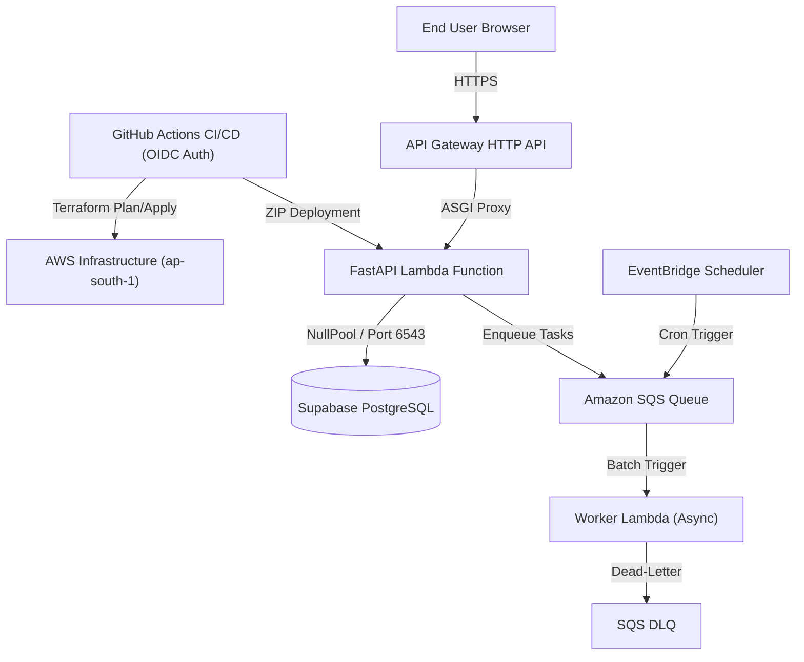

# Deployment Specification: AI Career Platform

> **Status**: Approved Foundation  
> **Audience**: DevOps, Cloud Architects, Backend Engineers  
> **Target Region**: AWS `ap-south-1` (Mumbai)  
> **Revision**: 1.0 (Phase 00)

---

## 1. Cloud Architecture & Infrastructure Model

The platform leverages an **AWS Serverless Architecture** in `ap-south-1` (Mumbai) to achieve high availability, low latency for Indian users, and near-zero idle infrastructure cost.



---

## 2. Component Specifications

### 2.1. FastAPI on AWS Lambda via Mangum
- **Adapter**: [Mangum](https://mangum.fastapiexpert.com/) translates AWS API Gateway v2 HTTP API payload events into ASGI HTTP requests and converts ASGI responses back into API Gateway payload format.
- **Entrypoint**:
  ```python
  from fastapi import FastAPI
  from mangum import Mangum
  from app.main import app

  handler = Mangum(app)
  ```
- **Runtime**: Python 3.12 (standard AWS Lambda managed runtime).
- **Packaging**: Standard uncompressed ZIP deployment package (< 250 MB). Managed via `uv export` to generate frozen wheel dependencies packaged cleanly into the deployment archive.

### 2.2. AWS API Gateway HTTP API
- **Protocol**: HTTP API (v2) provides cost-effective latency (up to 70% cheaper than REST API v1).
- **Features**: Automatic TLS termination, native CORS handling, JWT authorizer integration (optional direct validation), and payload proxying.

### 2.3. Asynchronous Tasks with Amazon SQS
- **Queues**:
  - `career-platform-tasks.fifo` or standard queue for background workloads (resume extraction, embeddings).
  - `career-platform-tasks-dlq` with `maxReceiveCount=3` for poison message handling.
- **Worker**: A dedicated lightweight Lambda function triggered by SQS batches (batch size 1–10, window 10s).

### 2.4. Scheduled Workloads with Amazon EventBridge Scheduler
- **Recurring Jobs**: Scheduled triggers (e.g. daily 06:00 AM IST email digest generation).
- **Target**: EventBridge triggers SQS directly using native IAM role permissions, completely avoiding custom scheduling servers.

---

## 3. Infrastructure as Code (Terraform)

All AWS infrastructure is codified using **Terraform** within `infra/terraform/`:
- **State Storage**: Remote encrypted Amazon S3 bucket with Amazon DynamoDB state locking.
- **Modules**:
  - `modules/api_gateway`: HTTP API, stages, CORS, and Lambda integration.
  - `modules/lambda`: Function execution roles, log retention, memory/timeout settings.
  - `modules/sqs`: Main queues, DLQs, and redrive policies.
  - `modules/scheduler`: EventBridge schedules and target bindings.
  - `modules/iam`: Least-privilege IAM execution roles for Lambda and GitHub Actions OIDC.

---

## 4. CI/CD & Secure GitHub Actions OIDC

To prevent credential leakage:
- **No Long-Lived AWS Keys**: We do **not** store `AWS_ACCESS_KEY_ID` or `AWS_SECRET_ACCESS_KEY` in GitHub Secrets.
- **OpenID Connect (OIDC)**: GitHub Actions assumes an ephemeral AWS IAM Role using short-lived JWT tokens:
  ```yaml
  permissions:
    id-token: write
    contents: read
  steps:
    - name: Configure AWS Credentials via OIDC
      uses: aws-actions/configure-aws-credentials@v4
      with:
        role-to-assume: arn:aws:iam::ACCOUNT_ID:role/GitHubActionsDeploymentRole
        aws-region: ap-south-1
  ```

---

## 5. Deployment Procedures & Rollbacks

1. **Pull Request Validation**:
   - `uv run ruff check .`
   - `uv run mypy .`
   - `uv run pytest`
   - `terraform fmt -check` and `terraform validate`
2. **Main Branch Deployment**:
   - Merges to `master` trigger automatic packaging and deployment.
   - Run Alembic migration job against Supabase direct connection.
   - Deploy backend Lambda ZIP package.
   - Run post-deployment smoke test (`GET /health`).
3. **Rollback Strategy**:
   - Lambda versions and aliases allow instantaneous rollback to previous stable versions (`aws lambda update-alias --function-name ... --function-version PREVIOUS_STABLE`).
