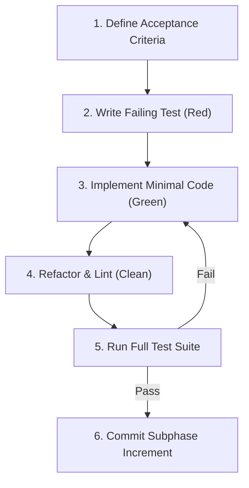

# Testing Strategy: AI Career Platform

> **Status**: Approved Foundation  
> **Audience**: Software Engineers, QA, AI Coding Agents  
> **Revision**: 1.0 (Phase 00)

---

## 1. Testing Philosophy & Test-Driven Development (TDD)

We follow strict **Test-Driven Development (TDD)** for all application logic:
1. **Understand Requirements**: Read the subphase specification and acceptance criteria.
2. **Write Tests First**: Create unit, integration, or contract tests that capture expected behaviour. Verify that tests fail for the right reasons.
3. **Minimal Implementation**: Write only enough production code to make the tests pass.
4. **Refactor**: Clean up the implementation while keeping tests green.
5. **No Test Weakening**: Never weaken, disable, or delete a legitimate failing test to force a pipeline green.



---

## 2. Test Pyramid & Scope

| Layer | Responsibility | Execution Speed | External Dependencies |
| :--- | :--- | :--- | :--- |
| **Unit Tests** | Domain business logic, deterministic match scoring rubric, preference parsers, schema validations | < 50ms per test | Completely isolated; pure in-memory functions |
| **Contract / Schema Tests** | Pydantic model serialization, API request/response validation | < 100ms per test | None |
| **Integration Tests** | FastAPI route handlers, database queries via SQLAlchemy, SQS message dispatch | 100ms - 1s per test | Local test DB or transactional rollbacks |
| **Agent Workflow Tests** | LangGraph state transitions, routing logic, prompt assembly | < 500ms per test | Mocked LLM clients; deterministic response fixtures |
| **Frontend Tests** | UI component rendering, form validations, accessibility audits | 200ms - 2s per test | React Testing Library, Playwright (planned) |

---

## 3. Testing AI & LLM Workflows Without Live APIs

### Critical Rule: Zero Paid External API Invocations in Automated Tests
Automated CI/CD pipelines and local test suites must **never** make live calls to external LLM providers (NVIDIA NIM, Cloudflare, OpenAI, OpenRouter, Gemini). 

### Testing Strategy for LangGraph Agents:
1. **Deterministic Mock Fixtures**:
   - Provide pre-recorded or synthetic JSON/text responses that mimic expected LLM outputs for given prompts.
2. **Fake Provider Client (`FakeLLMClient`)**:
   - Create an in-memory test implementation of the `LLMClient` protocol that returns controlled outputs based on input prompt signatures.
3. **State Transition Validation**:
   - Test that LangGraph nodes accurately update `CandidateState` (e.g. updating goals, recording dealbreakers, routing between agents).
4. **Guardrail & Injection Tests**:
   - Verify that malicious inputs (prompt injections inside uploaded resume text) are neutralized by the system prompt template without breaking the graph.

```python
# Example: Testing Agent State Transition with Deterministic Mock
import pytest
from app.modules.agent.graph import create_career_graph
from app.modules.agent.providers import FakeLLMClient

@pytest.mark.asyncio
async def test_career_discovery_agent_updates_dealbreakers():
    fake_llm = FakeLLMClient(canned_responses={
        "analyze_goals": '{"dealbreakers": ["No unpaid internships", "No 6-day workweek"]}'
    })
    graph = create_career_graph(llm_client=fake_llm)
    
    initial_state = {"messages": ["I strictly want 5-day workweeks and no unpaid roles"], "dealbreakers": []}
    result = await graph.ainvoke(initial_state)
    
    assert "No unpaid internships" in result["dealbreakers"]
    assert "No 6-day workweek" in result["dealbreakers"]
```

---

## 4. Database Integration Testing

When testing database operations with SQLAlchemy 2.0:
1. **Isolated Test Database**: Local tests run against an ephemeral PostgreSQL instance (via Docker Compose) with `pgvector` enabled.
2. **Transaction Rollback Fixture**: Each test function runs within an isolated database transaction that rolls back automatically upon completion:
   ```python
   @pytest.fixture
   async def db_session():
       async with test_engine.connect() as conn:
           trans = await conn.begin()
           async_session = AsyncSession(bind=conn, expire_on_commit=False)
           yield async_session
           await trans.rollback()
   ```
3. **No Migration in Unit Tests**: Schema setup for tests is handled by running Alembic against the test database once prior to the test suite run.

---

## 5. Running Tests Locally

All backend tests are executed using `pytest` inside the `apps/api` environment:
```bash
cd apps/api

# Run all unit and mock tests
uv run pytest

# Run tests with verbose output and coverage report
uv run pytest -v --cov=app

# Run a specific test module
uv run pytest tests/unit/test_matching_rubric.py
```
