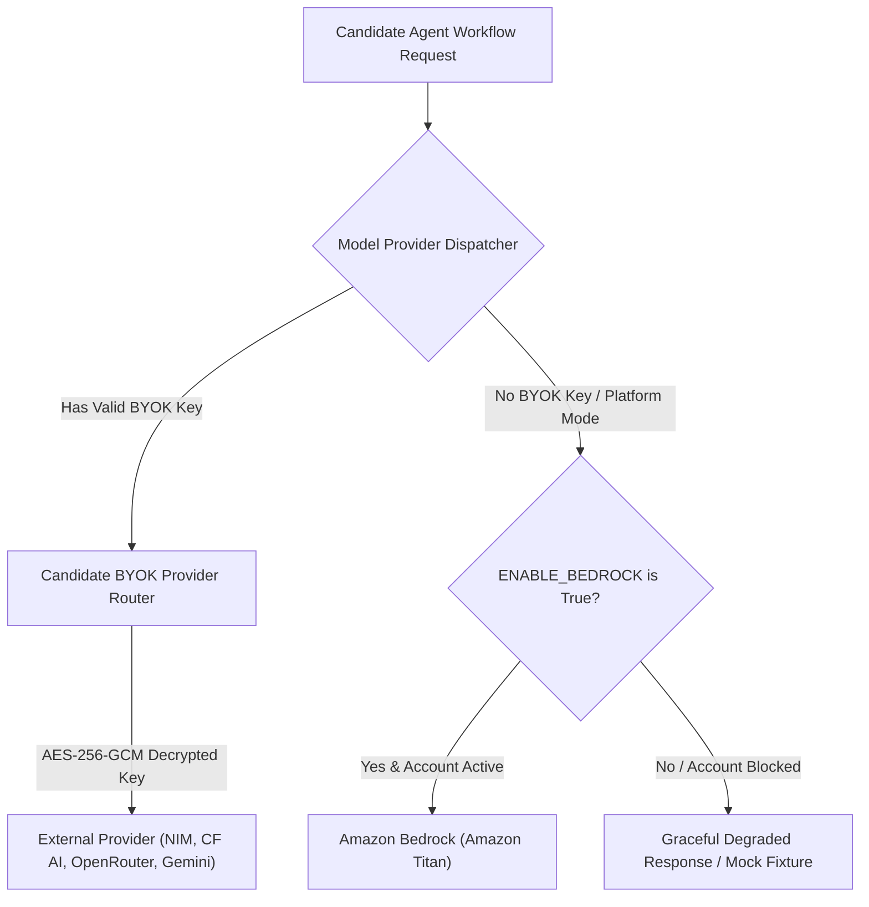

# ADR-016: Amazon Bedrock Foundation Model Integration and Resilience Abstraction

- **Status**: Accepted
- **Date**: 2026-11-21
- **Authors**: Technical Lead, Architecture Engineer

---

## 1. Context
The AI Career Platform requires foundation model (LLM) capabilities to power conversational career goal intake, resume bullet tailoring, structured entity extraction, and transparent match explanations via LangGraph agent workflows.

We are establishing our foundation model strategy under an AWS-native architecture while confronting a critical real-world operational constraint:
1. **Account-Level Bedrock Access Blocker**: Our AWS account currently experiences a throttling/quota blocker on Amazon Bedrock foundation model invocations. An official AWS Support case is currently open and actively being resolved.
2. **Development Continuity Mandate**: Platform development, testing, and milestone delivery **must not stall** waiting for external AWS Support resolution.
3. **Model Selection Boundaries**: **Anthropic models are explicitly excluded** from our planned inference stack due to cost and licensing constraints. We target cost-effective AWS-native models (such as Amazon Titan) and external budget alternatives.
4. **Preservation of BYOK Architecture**: The platform's foundational principle of allowing candidates to Bring Your Own Key (BYOK) for third-party providers must remain fully supported and architecturally decoupled.

---

## 2. Decision

### 2.1. Provider Abstraction Architecture (`LLMClient`)
Abstract all foundation model interactions behind a strict, provider-agnostic Python interface (`LLMClient` protocol) in `apps/api/app/modules/agent/providers/base.py`:

```python
class LLMClient(Protocol):
    async def generate_text(
        self,
        prompt: str,
        system_instruction: str | None = None,
        temperature: float = 0.2,
        max_tokens: int = 1024,
    ) -> str: ...

    async def generate_structured(
        self,
        prompt: str,
        schema: type[BaseModel],
        system_instruction: str | None = None,
    ) -> BaseModel: ...
```

### 2.2. Amazon Bedrock Integration & Operational Decoupling
1. **Bedrock Client Implementation**: Implement a Bedrock provider (`BedrockLLMClient`) using AWS SDK (`aioboto3` / `boto3`) targeting Amazon Titan models (e.g. `amazon.titan-text-express-v1` or `amazon.titan-text-lite-v1`).
2. **Explicit Exclusion of Anthropic**: Anthropic models (Claude) are **not** part of the planned production stack. All prompts, parameter schemas, and token caps must target standard, economical model families.
3. **Feature Flagging & Graceful Degradation**:
   - Introduce an explicit configuration flag: `ENABLE_BEDROCK: bool = False` (defaulting to `False` while the AWS Support case is pending).
   - The application checks `ENABLE_BEDROCK` at startup and during request routing.
   - When `ENABLE_BEDROCK=false` or when Bedrock raises throttling (`ThrottlingException`), quota errors (`ServiceQuotaExceededException`), or access denied (`AccessDeniedException`), the application handles the condition gracefully:
     - In local/CI environments: Routes to deterministic mock providers (`FakeLLMClient`).
     - In production: Falls back to candidate BYOK providers or returns a clear, user-friendly service message rather than crashing with unhandled 500 errors.

### 2.3. Dual Model Operating Model: Bedrock Platform Tier vs. Candidate BYOK
The architecture maintains a clear separation between platform-provided inference and candidate-provided inference:



1. **Platform-Provided Bedrock Tier**:
   - Used for core platform features (initial resume entity extraction, standard daily digest summaries) once quota access is restored.
   - Billed against the platform's AWS account and subject to centralized spend caps and alarms.
2. **Candidate Bring Your Own Key (BYOK) Tier**:
   - Candidates can optionally connect personal API keys for NVIDIA NIM, Cloudflare Workers AI, OpenRouter, or Google Gemini.
   - Candidate keys are encrypted at rest using AES-256-GCM authenticated envelope encryption (ADR-009).
   - Zero marginal token cost to the platform; candidate requests bypass Bedrock quotas entirely.

### 2.4. Zero Paid Calls in Automated Testing
- **Mandatory Testing Rule**: Under no circumstances will automated tests, local runs, or CI/CD pipelines invoke live, paid model endpoints (Bedrock or external).
- **Deterministic Mocking**: All LangGraph agent tests use `FakeLLMClient` returning pre-recorded or synthetic responses (ADR-009, [docs/TESTING_STRATEGY.md](../TESTING_STRATEGY.md)).

---

## 3. Alternatives Considered

- **Hard Dependency on Bedrock (Blocking Development)**:
  - *Evaluation*: Wait for AWS Support case resolution before proceeding.
  - *Reason for Rejection*: Violates project momentum. AI agent state machines, schemas, scoring rubrics, and database entities can be 100% implemented, tested, and validated using mock providers.
- **Anthropic Claude Models on Bedrock**:
  - *Evaluation*: Highly capable reasoning models.
  - *Reason for Rejection*: Substantially higher token costs (\$3.00–\$15.00/million tokens) that would rapidly exhaust our \$200 AWS credit budget. Amazon Titan and small open models provide sufficient capability for entity extraction and deterministic rubric matching at a fraction of the cost.
- **Self-Hosted LLMs on AWS (EC2 GPU / SageMaker)**:
  - *Reason for Rejection*: Incurs prohibitive fixed hourly charges (minimum \$100–\$500/month for dedicated GPU instances). Violates the strict prohibition on always-on servers.

---

## 4. Consequences

### Positive
- Development proceeds immediately without waiting for AWS Support.
- Total decoupling: Changing LLM providers requires zero modifications to LangGraph agent graphs.
- Protects the \$200 budget from unexpected foundation model overage charges.
- Retains candidate privacy and zero platform liability via the BYOK architecture.

### Negative
- Platform-provided live AI features cannot be verified against Bedrock until the AWS Support case is resolved.
- Prompts must be maintained to adhere to common denominator capabilities across Titan and BYOK models.

---

## 5. Security Implications
- **Prompt Injection Defense**: All inputs (resumes, job postings) are treated as untrusted input. The application enforces out-of-band schema validation and tenant authorization checks regardless of the model provider.
- **Credential Protection**: Bedrock calls use AWS IAM execution roles (zero static keys). Candidate BYOK keys are encrypted with AES-256-GCM.
- **No PII Leakage**: Logging filters redact candidate PII and authentication headers from model request/response logs.

---

## 6. Cost Implications
- **Bedrock Pricing (Titan Text)**: Billed strictly on-demand per 1,000 input/output tokens (typically \$0.0008/1k input, \$0.0016/1k output for Titan Express; even less for Titan Lite).
- **Zero Idle Cost**: When idle, Bedrock incurs **\$0.00**.
- **BYOK Tier**: **\$0.00** platform cost.

---

## 7. Risks and Mitigations
- **Risk**: Prolonged delay in AWS Support case resolution.
  - *Mitigation*: The platform continues full development and testing using `FakeLLMClient` and candidate BYOK integrations. Bedrock activation is purely an infrastructure configuration switch once access is confirmed.

---

## 8. References
- [Amazon Bedrock User Guide](https://docs.aws.amazon.com/bedrock/latest/userguide/what-is-bedrock.html)
- [Amazon Bedrock Pricing](https://aws.amazon.com/bedrock/pricing/)
- [docs/TESTING_STRATEGY.md](../TESTING_STRATEGY.md)
- [docs/SECURITY.md](../SECURITY.md)
