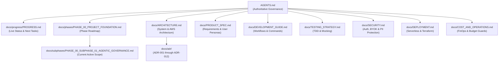

# Walkthrough: Phase 00, Subphase 01 — Engineering Governance & Architecture Documentation

> **Subphase**: `PHASE_00_SUBPHASE_01`  
> **Subphase Name**: Engineering Governance, Architecture Documentation and AI-Agent Development System  
> **Branch**: `phase-00/subphase-01-agentic-governance`  
> **PR**: [GitHub PR #1](https://github.com/shubhojit-mitra-dev/ai-job-agent/pull/1)  
> **Author**: Senior Documentation and Architecture Engineer  
> **Status**: Completed (Updated Post-Review)

---

## 1. What Was Accomplished

In this subphase, we established a complete, professional, and self-documenting engineering governance environment for the **AI Career Platform** monorepo (`ai-job-agent`).

Key accomplishments:
1. **Established Authoritative Governance**: Authored root `AGENTS.md` and pointer `CLAUDE.md`, codifying mandatory reading order, modular monolith constraints, coding/testing standards, security rules, and PR lifecycle requirements.
2. **Updated Project Documentation**: Rewrote `README.md` to accurately reflect the product vision, current scaffolded status, and quickstart instructions without claiming unimplemented capabilities or unauthorized licenses.
3. **Drafted Core Technical Specifications**:
   - `PRODUCT_SPEC.md`: Product vision, target Indian user personas, functional requirements, and strict MVP boundaries.
   - `ARCHITECTURE.md`: Modular monolith design, AWS serverless model (Lambda + Mangum + API Gateway HTTP API), SQS async task workers, EventBridge scheduling with timezone `Asia/Kolkata`, and Supabase connection pooling safeguards.
   - `DEVELOPMENT_GUIDE.md`: Monorepo conventions, `uv` workflows, `npm ci` for frontend, formatting, typing, and branch standards.
   - `TESTING_STRATEGY.md`: TDD cadence, deterministic mock testing for LLM workflows without live paid API calls, and isolated database fixtures.
   - `SECURITY.md`: Supabase Auth token validation, SQLAlchemy database role boundaries, defense-in-depth tenant isolation (application filters + RLS), candidate resume PII protection, BYOK AES-GCM envelope encryption, and prompt injection defense.
   - `DEPLOYMENT.md`: Infrastructure topology in AWS `ap-south-1` (Mumbai), Terraform IaC with S3-native state locking, and GitHub Actions OIDC (no static cloud keys).
   - `COST_AND_OPERATIONS.md`: Cost management policies (strictly no EC2, no NAT Gateway, no ElastiCache, no RDS), consistent 7-day CloudWatch log retention, and budget alerts.
4. **Codified Architectural Decision Records**: Created ADR-001 through ADR-012 with strictly accurate statuses (`Accepted` for ADR-001 through ADR-010; `Proposed` for ADR-011 and ADR-012).
5. **Formulated Phase & Subphase Management**:
   - Outlined 5 subphases for `PHASE_00` in `docs/phases/PHASE_00_PROJECT_FOUNDATION.md`.
   - Detailed only the active subphase in `docs/subphases/PHASE_00_SUBPHASE_01_AGENTIC_GOVERNANCE.md`.
6. **Initialized Progress & Tracking**: Initialized live tracking in `docs/progress/PROGRESS.md`.
7. **Strict Scope Discipline**: Zero modifications were made to existing application code (`apps/api/app/main.py`), and no database or cloud resources were touched.

---

## 2. File Changes Summary

### Root Files Created / Modified
- [AGENTS.md](../../AGENTS.md): Authoritative instructions for all coding agents.
- [CLAUDE.md](../../CLAUDE.md): Direct pointer to `AGENTS.md`.
- [README.md](../../README.md): Professional project README with architecture and setup details.

### Core Architecture & Governance Documentation Created
- [docs/PRODUCT_SPEC.md](../PRODUCT_SPEC.md)
- [docs/ARCHITECTURE.md](../ARCHITECTURE.md)
- [docs/DEVELOPMENT_GUIDE.md](../DEVELOPMENT_GUIDE.md)
- [docs/TESTING_STRATEGY.md](../TESTING_STRATEGY.md)
- [docs/SECURITY.md](../SECURITY.md)
- [docs/DEPLOYMENT.md](../DEPLOYMENT.md)
- [docs/COST_AND_OPERATIONS.md](../COST_AND_OPERATIONS.md)

### Architectural Decision Records Created (`docs/adr/`)
- [ADR-001: Modular Monolith Architecture](../adr/ADR-001-modular-monolith-architecture.md) (Accepted)
- [ADR-002: FastAPI Deployment on AWS Lambda Using Mangum and ZIP Packaging](../adr/ADR-002-fastapi-aws-lambda-mangum-zip.md) (Accepted)
- [ADR-003: Supabase Auth and PostgreSQL](../adr/ADR-003-supabase-auth-and-postgresql.md) (Accepted)
- [ADR-004: SQLAlchemy 2.0 and Alembic](../adr/ADR-004-sqlalchemy-2-and-alembic.md) (Accepted)
- [ADR-005: SQS-Based Background Processing](../adr/ADR-005-sqs-background-processing.md) (Accepted)
- [ADR-006: EventBridge Scheduler for Scheduled Workloads](../adr/ADR-006-eventbridge-scheduler.md) (Accepted)
- [ADR-007: Terraform for Infrastructure as Code](../adr/ADR-007-terraform-infrastructure-as-code.md) (Accepted)
- [ADR-008: GitHub Actions with AWS OIDC](../adr/ADR-008-github-actions-with-aws-oidc.md) (Accepted)
- [ADR-009: BYOK Provider Abstraction for LLM Inference](../adr/ADR-009-byok-provider-abstraction.md) (Accepted)
- [ADR-010: Hybrid Job Retrieval and Deterministic Recommendation Ranking](../adr/ADR-010-hybrid-job-retrieval-and-deterministic-ranking.md) (Accepted)
- [ADR-011: Local Embedding Strategy and Its Deployment Constraints](../adr/ADR-011-local-embedding-strategy-and-deployment-constraints.md) (Proposed)
- [ADR-012: Resume File Storage and Secure Access](../adr/ADR-012-resume-file-storage-and-secure-access.md) (Proposed)

### Phase & Progress Documentation Created
- [docs/phases/PHASE_00_PROJECT_FOUNDATION.md](../phases/PHASE_00_PROJECT_FOUNDATION.md)
- [docs/subphases/PHASE_00_SUBPHASE_01_AGENTIC_GOVERNANCE.md](../subphases/PHASE_00_SUBPHASE_01_AGENTIC_GOVERNANCE.md)
- [docs/progress/PROGRESS.md](../progress/PROGRESS.md)
- [docs/walkthroughs/WALKTHROUGH_PHASE_00_SUBPHASE_01.md](./WALKTHROUGH_PHASE_00_SUBPHASE_01.md)

---

## 3. Important Implementation & Architectural Decisions

### 3.1. Supabase Transaction Pooler & Serverless SQLAlchemy
In [docs/ARCHITECTURE.md](../ARCHITECTURE.md) and [ADR-003](../adr/ADR-003-supabase-auth-and-postgresql.md), we established critical connection rules for AWS Lambda execution:
- **Port 6543 (Transaction Mode)**: The serverless application runtime connects to Supabase PgBouncer/Supavisor on port 6543 with `poolclass=NullPool`.
- **Prepared Statement Workaround**: `asyncpg` caches prepared statements by default. Because PgBouncer in transaction mode assigns arbitrary backend connections to each transaction, cached prepared statements cause fatal `"prepared statement does not exist"` errors. The engine must enforce `connect_args={"statement_cache_size": 0}`.
- **Direct Port 5432 for Alembic**: Alembic migrations require session locks and transaction-level DDL commands that are unsupported in transaction pooling mode. Alembic connects directly to port 5432 outside the Lambda runtime.

### 3.2. Database Security & Tenant Isolation
In [docs/SECURITY.md](../SECURITY.md) and [docs/ARCHITECTURE.md](../ARCHITECTURE.md), we clarified the authentication boundary:
- Supabase Auth validates JWTs at the FastAPI middleware layer, extracting the candidate UUID (`sub`).
- Supabase Auth does **not** protect direct SQLAlchemy connections. SQLAlchemy connects as an application database role.
- Tenant isolation is enforced at the application level on every query (`WHERE user_id = current_user.id`).
- Defense in depth is provided by evaluating least-privileged database roles and transaction session context variables (`SET LOCAL app.current_user_id = :uid`) to drive PostgreSQL Row-Level Security (RLS) policies.

### 3.3. SQS Visibility Timeout Best Practice
In [ADR-005](../adr/ADR-005-sqs-background-processing.md) and [docs/DEPLOYMENT.md](../DEPLOYMENT.md), we codified the AWS best-practice relationship:
- Queue visibility timeout must be configured to **at least six times the consumer Lambda timeout**, factoring in batching windows and retry behavior.

### 3.4. Consistent Scheduled Timezone
In [ADR-006](../adr/ADR-006-eventbridge-scheduler.md) and [docs/ARCHITECTURE.md](../ARCHITECTURE.md), scheduled crons are standardized:
- EventBridge Scheduler explicitly specifies timezone **`Asia/Kolkata`** with daily digest triggers set to **06:00 AM IST** (`cron(0 6 * * ? *)`).

### 3.5. Terraform S3-Native State Locking
In [ADR-007](../adr/ADR-007-terraform-infrastructure-as-code.md) and [docs/DEPLOYMENT.md](../DEPLOYMENT.md):
- Remote state is stored in S3 using S3-native state locking (`use_lockfile = true`), completely avoiding separate DynamoDB table costs.

### 3.6. Resume Storage Evaluation (ADR-012)
In [ADR-012](../adr/ADR-012-resume-file-storage-and-secure-access.md), the status is marked **Proposed**:
- Evaluates Supabase Storage (consolidated ecosystem, RLS integration) versus Amazon S3 in `ap-south-1` (co-located compute, zero intra-region egress, native IAM, lifecycle rules) without silently selecting one.

### 3.7. Prompt Injection Defense
In [docs/SECURITY.md](../SECURITY.md) and [docs/TESTING_STRATEGY.md](../TESTING_STRATEGY.md):
- Resumes and job postings are treated as untrusted input. Delimiters provide context separation but are not security boundaries.
- LLM outputs never independently authorize privileged actions. Tool capabilities are strictly allowlisted and authorized out-of-band.

---

## 4. Document Interrelationships & Reading Order

The documentation suite forms a coherent hierarchy:



---

## 5. Verification Performed & Validation Results

1. **File Cross-Link Verification**:
   - Zero machine-specific (`file:///home`) links remain in any Markdown document across the repository.
   - All relative links have been verified against filesystem paths.
2. **Mermaid Diagram Validation**:
   - Verified that all Mermaid diagrams in `docs/PRODUCT_SPEC.md`, `docs/ARCHITECTURE.md`, `docs/TESTING_STRATEGY.md`, `docs/SECURITY.md`, `docs/DEPLOYMENT.md`, and this walkthrough compile cleanly.
3. **Application Code Integrity**:
   - Ran `git status` to ensure zero application code was modified.
   - Tested FastAPI `/health` endpoint to ensure application continues to function cleanly:
     ```bash
     cd apps/api && uv run python -c "from app.main import app; from starlette.testclient import TestClient; client = TestClient(app); res = client.get('/health'); assert res.status_code == 200"
     ```
     Result: **Verified Clean (HTTP 200)**.
4. **Scope Adherence**:
   - Zero database engines, models, migrations, or AWS resources were implemented.
   - All work was strictly confined to documentation and governance.

---

## 6. Commit & Pull Request Reference

- **Pull Request**: [GitHub PR #1](https://github.com/shubhojit-mitra-dev/ai-job-agent/pull/1)
- **Branch**: `phase-00/subphase-01-agentic-governance`
